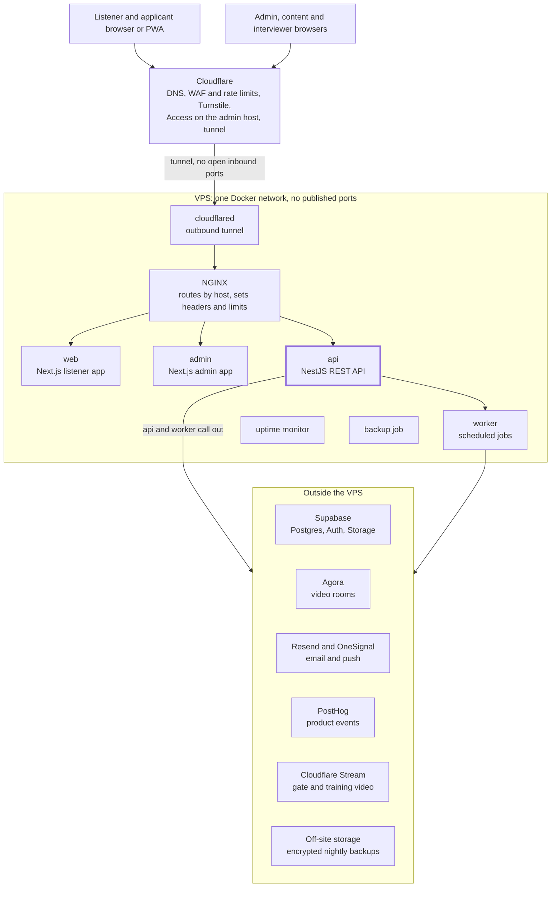

# 3. System architecture

The system is one VPS running a modular monolith (an API and a worker) and two web apps, with Supabase holding all data and vendors handling video, email, push and analytics.

The highlighted `api` holds every business rule; `web` and `admin` only render, and `worker` shares the API's code and runs the timed jobs from a queue in Postgres. Browsers also talk directly to Supabase Auth for sign-in and to Agora for video, using short-lived tokens the API issues. Nothing on the VPS is reachable from the internet except through Cloudflare.
