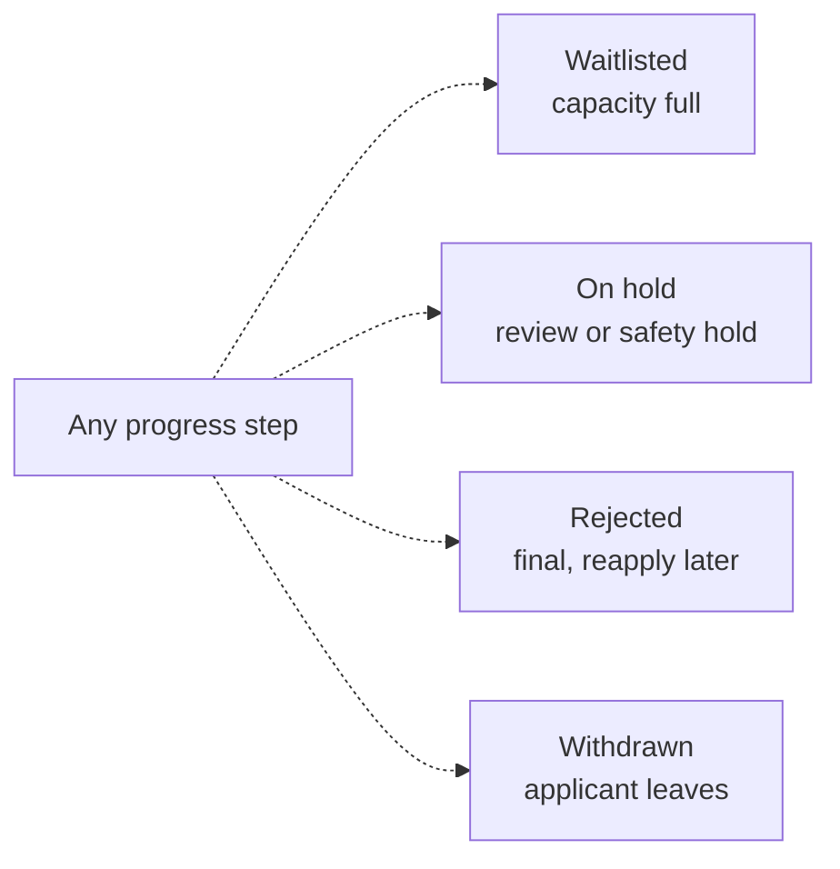

# 4. Listener journey and state machine

The journey has 13 progress states and four side states, down from the 22 in the requirements, because reminders, attendance and receipts are events, not states.

```mermaid
stateDiagram-v2
  direction LR
  [*] --> Registered
  Registered --> EmailVerified
  EmailVerified --> ProfileComplete
  ProfileComplete --> QuestionnaireSubmitted
  QuestionnaireSubmitted --> TriagePassed
  TriagePassed --> IDSubmitted: ID requested only after triage passes
  IDSubmitted --> IDApproved
  IDApproved --> InterviewScheduled
  InterviewScheduled --> InterviewPassed
  InterviewPassed --> TrainingUnlocked: training unlocks after the interview is passed
  TrainingUnlocked --> TrainingInProgress
  TrainingInProgress --> TrainingCompleted
  TrainingCompleted --> VerifiedListener
  VerifiedListener --> [*]

  state "Email verified" as EmailVerified
  state "Profile complete" as ProfileComplete
  state "Questionnaire submitted" as QuestionnaireSubmitted
  state "Triage passed" as TriagePassed
  state "ID submitted" as IDSubmitted
  state "ID approved" as IDApproved
  state "Interview scheduled" as InterviewScheduled
  state "Interview passed" as InterviewPassed
  state "Training unlocked" as TrainingUnlocked
  state "Training in progress" as TrainingInProgress
  state "Training completed" as TrainingCompleted
  state "Verified listener" as VerifiedListener
```

Side states, reachable from most steps:

Every transition is logged: actor, from, to, time, reason, metadata.

Before Registered the visitor passes the video gate and receives a single-use completion token. Waitlisted applies when intake capacity is full, On hold covers a pending review or a safety concern, and a Rejected applicant who reapplies after the cool-down starts a new application rather than reopening the old one. Payment, if a fee exists, happens inside Training unlocked.
